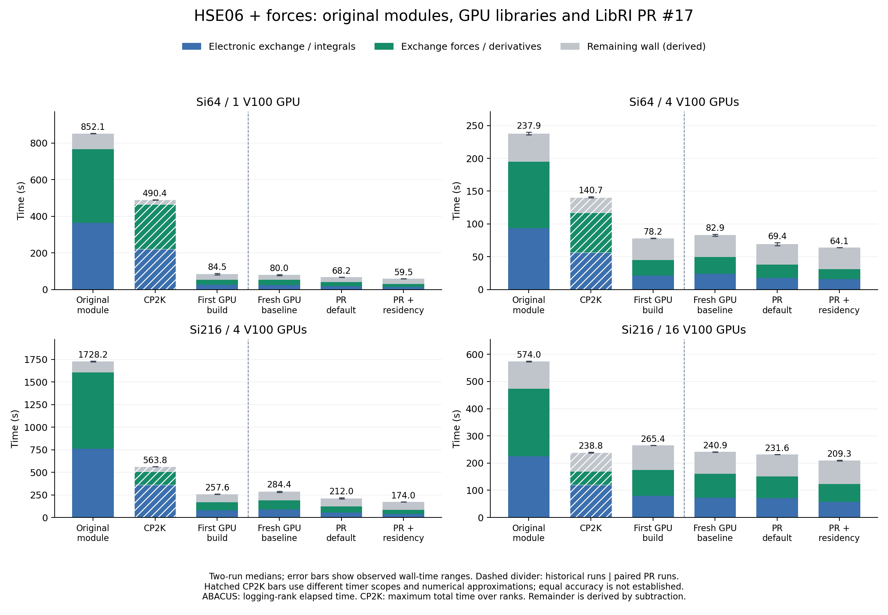

# Historical CP2K and old/new ABACUS timing analysis

This appendix adds the original CP2K and ABACUS module results and the first GPU-library build to the controlled LibRI backend / PR comparisons in [TIMER_ANALYSIS.md](TIMER_ANALYSIS.md). All measurements used the SAI `16V100` partition, one MPI rank and four physical CPU cores per allocated V100, OpenMP=4 and BLAS threads=1. Wall times include initial GGA/PBE SCF, HSE06 SCF, and complete atomic forces; stress is disabled. The main tables use ideal Si64/Si216 cells and two fresh starts per entry.

**All-version wall times (seconds).** The original module and CP2K entries use the accepted final force-benchmark runs, not the earlier exploratory CP2K runs with loose force screening. Historical and fresh GPU-baseline timings are separate measurements of the same executable. Only the fresh baseline is used to evaluate the PR.

| Case | Original ABACUS module | CP2K final | First GPU build | Fresh GPU baseline | PR default | PR + residency |
| --- | --- | --- | --- | --- | --- | --- |
| si64-g1 | 852.13 | 490.43 | 84.50 | 79.95 | 68.20 | 59.52 |
| si64-g4 | 237.88 | 140.67 | 78.20 | 82.92 | 69.39 | 64.11 |
| si216-g4 | 1728.23 | 563.77 | 257.64 | 284.45 | 211.96 | 174.00 |
| si216-g16 | 574.04 | 238.80 | 265.37 | 240.95 | 231.56 | 209.35 |

The original ABACUS module and the new builds share ABACUS commit `4e9f1636b7ca27d1dc634711915c18087654b911`. The module used CPU/OpenMP LibRI `2.1.1-b0eff7a`; the first GPU build used LibRI `0e8afc3`, DDLA `7c0ca08`, LibXC `3c7794c`, and ABACUS integration patches. Thus “old/new” is a dependency/build comparison, not an ABACUS source-version comparison. Original and first-GPU runs used different nodes. Node names, repeat ranges, and phase definitions are retained in `results/all-version-summary.csv` and `results/all-version-runs.csv`.

**Si216 / 4 GPUs: where the time went (seconds).** For ABACUS the exchange columns are `Exx_LRI.cal_exx_elec` and `Exx_LRI.cal_exx_force`. For CP2K they are the HSE run’s `integrate_four_center` and `derivatives_four_center`; these have different scope and rank aggregation from ABACUS. The remainder is external wall minus the two exchange timers, including all other work, waits and launcher overhead. It is an approximate diagnostic, not an independently measured phase.

| Configuration | Wall | Electronic exchange / integrals | Exchange forces / derivatives | Remaining wall |
| --- | --- | --- | --- | --- |
| Original ABACUS module (CPU LibRI) | 1728.23 | 759.13 | 848.69 | 120.41 |
| CP2K, final force settings | 563.77 | 360.10 | 146.94 | 56.72 |
| First GPU-library build, original timings | 257.64 | 80.06 | 87.31 | 90.27 |
| Same GPU baseline, fresh PR timings | 284.45 | 87.74 | 103.55 | 93.16 |
| PR #17 default | 211.96 | 56.27 | 64.12 | 91.58 |
| PR #17 + C/V residency | 174.00 | 39.66 | 44.23 | 90.11 |

From the original module to the first GPU build, electronic exchange saves 679.07 s and exchange forces 761.38 s: together 97.95% of the 1470.59 s wall-time reduction. The GGA+HSE SCF parent drops 822.19 -> 124.42 s and complete forces drop 855.74 -> 89.87 s. These parent timers include the exchange children and must not be added again. The ABACUS SCF iteration counts are unchanged across builds: 12 GGA + 8 HSE for Si64, 12 GGA + 7 HSE for Si216.

| Case: module -> first GPU build | Wall saved / s | Electronic EXX saved / s | EXX forces saved / s | Remainder saved / s |
| --- | --- | --- | --- | --- |
| si64-g1 | 767.64 | 338.39 | 374.02 | 55.23 |
| si64-g4 | 159.68 | 71.96 | 77.92 | 9.81 |
| si216-g4 | 1470.59 | 679.07 | 761.38 | 30.14 |
| si216-g16 | 308.68 | 145.04 | 153.54 | 10.10 |

**Displaced Si64 / 4 GPUs: the CPU control matters.** The following measurements were made on the same node `16v100n17`, with identical inputs and resources, one start each and 12 GGA + 12 HSE iterations. The four backend combinations ran consecutively in one allocation, with tracing enabled; the original-module control was a separate allocation on that node.

| Build / backend | Wall / s | Electronic EXX / s | EXX forces / s | Remaining wall / s |
| --- | --- | --- | --- | --- |
| Original module, fresh displaced control | 291.51 | 141.70 | 102.39 | 47.42 |
| New build, LibRI CPU / LibXC CPU | 135.69 | 59.53 | 39.18 | 36.98 |
| New build, LibRI GPU / LibXC CPU | 88.20 | 29.04 | 20.75 | 38.41 |
| New build, LibRI CPU / LibXC GPU | 129.87 | 58.44 | 39.00 | 32.43 |
| New build, LibRI GPU / LibXC GPU | 82.90 | 28.74 | 21.33 | 32.83 |

Even with both new libraries on CPU, wall time decreases from 291.51 to 135.69 s, with electronic EXX 141.70 -> 59.53 s and EXX forces 102.39 -> 39.18 s. This gain already exists before selecting GPU backends; the experiment does not isolate its dependency/build causes. Holding LibXC on CPU, selecting LibRI GPU then reduces wall time 135.69 -> 88.20 s, electronic EXX 59.53 -> 29.04 s and EXX forces 39.18 -> 20.75 s. The corresponding wall reduction with LibXC fixed on GPU is 129.87 -> 82.90 s. These controlled switches support 1.54x / 1.57x LibRI-backend speedups; the much larger historical old/new ratios cannot be attributed entirely to GPU execution.

**CP2K timing scopes.** CP2K is pinned to `356586e108ea6f7afb60a0a1ac3c2ad98805eeb6`. Its HSE input uses DZVP-MOLOPT-SR-GTH, GTH-PBE-q4, cFIT3 ADMM, 400/60 Ry, EPS_SCF=1e-7, EPS_SCHWARZ=EPS_SCHWARZ_FORCES=1e-6, and exchange cutoff radii 5 angstrom for Si64 / 6 angstrom for Si216. Each starts with a separate PBE seed and then HSE OT; wall time sums both launches. All accepted runs have 8 PBE and 7 HSE iterations; the HSE timer records 8 integral calls and one derivative call.

| Case | PBE seed wall / s | hfx_ks_matrix (parent) / s | integrate_four_center / s | derivatives_four_center / s | PBE + HSE SCF / s |
| --- | --- | --- | --- | --- | --- |
| si64-g1 | 9.16 | 465.68 | 221.28 | 244.39 | 225.27 |
| si64-g4 | 10.25 | 117.30 | 56.43 | 60.87 | 65.81 |
| si216-g4 | 23.85 | 507.06 | 360.10 | 146.94 | 379.87 |
| si216-g16 | 32.51 | 170.50 | 119.83 | 50.66 | 156.85 |

`hfx_ks_matrix` calls both four-center integrals and force derivatives, as shown in the [pinned source](evidence/timer-scope-sources/hfx_admm_utils.F) (calls at lines 1281/1361 and 1305/1379). It is not an electronic-only EXX timer and must not be added to the derivative timer. Similarly, `qs_forces` contains energies and SCF and is not a force-only phase. The historical parser’s CP2K field named `exx_s` represented this parent; the collected historical JSON renames it to `hfx_ks_matrix_s`, and the new all-version exports use the two child scopes explicitly.

CP2K’s four-center integrals and derivatives dominate these runs. For Si216/4 GPUs they account for 360.10 + 146.94 = 507.04 s of the 563.77 s workflow; the PBE seed alone takes 23.85 s. For Si64/1 GPU the corresponding values are 221.28 + 244.39 s of 490.43 s. The CP2K columns consistently use `TOTAL TIME MAXIMUM` over MPI ranks. ABACUS reports elapsed timers on the logging rank, with work and waits included; these are not GPU-kernel timings. Maxima of CP2K child timers can come from different ranks, so their sum is not an exact rank-resolved decomposition.

**Comparison limits and evidence.** The CP2K / ABACUS comparison uses different pseudopotentials, bases, ADMM / exchange truncation versus RI screening, and SCF criteria. It does not establish equal numerical accuracy or an accuracy-normalized code ranking. CP2K’s short radii retain the original truncation warning. Only the final 1e-6 force-screening runs enter the timing table; the earlier fast 1e-4 force runs are excluded. The original report records the parameter-tightening checks and their limits. Absolute total energies are not compared between programs.

Three first-GPU timing drivers exited 127 during post-calculation recording, after ABACUS itself exited 0. Their independent wall/exit records, convergence, full forces and numerical checks passed, so those scientific runs are retained. The driver failures remain explicit in the all-version exports and `evidence/history-checks/gpu-first/evidence-validation.json`. Later repeats completed normally. The accepted original Si216/4-GPU module run also remains valid despite cancellation of its batch’s redundant later work; acceptance is based on each calculation’s output and exit record.

The package contains 31 core backend/PR runs plus 25 historical runs: 8 original-module timings, 8 accepted CP2K timings (both PBE and HSE logs), 8 first-GPU timings, and the displaced module control. Historical inputs and logs are under `evidence/history/`; original reports and checks are under `evidence/history-checks/`. Archived reports retain their original references to separate campaign artifacts; use this appendix and the package README for the current bundle layout. CP2K inputs require the pinned module’s BASIS_MOLOPT, BASIS_ADMM and GTH_POTENTIALS data. ABACUS potential/orbital assets are in `cases/`. The historical launch commands are preserved under `evidence/original-scripts/original/` and `gpu-first/`. The original module-comparison input package, including final CP2K and ABACUS cases and its Slurm launcher, is included unchanged as `evidence/history-checks/original/reproduce-inputs.tar.gz`; extract it in a new directory and follow its README-REPRODUCE.md to rerun on SAI. The first GPU build can use the five core ABACUS inputs and the baseline executable described in BUILD.md.

Recompute and verify the 25 historical runs with `python3 scripts/analyze-history.py`; add `--plot` for PNG/SVG generation with matplotlib. The 31 core runs are checked by `python3 scripts/verify.py`. These commands analyze existing evidence and do not launch electronic-structure calculations. `results/history-timer-rows.csv` retains every printed historical timer, and the all-version / attribution CSV and JSON files retain unrounded derived values.
