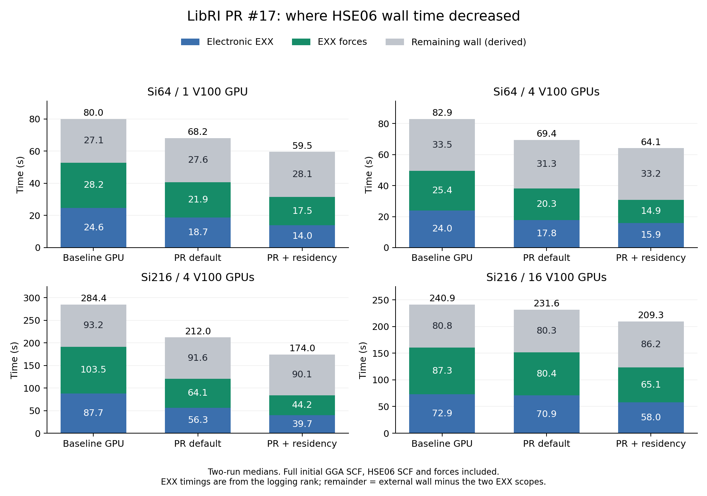

Track integration of CUDA-enabled LibXC and LibRI/DDLA into ABACUS's LCAO HSE06 potential, exact-exchange, and force calculations. The experimental integration passes the Si energy/force comparisons below. This issue records the patches, pinned versions, original inputs and outputs, and three distinct comparisons: the original modules versus the GPU-library build, CPU/GPU backend selection within one executable, and the additional effect of LibRI PR #17.

**Every reported wall time includes fresh initialization, the initial GGA/PBE SCF, HSE06 SCF, and complete atomic forces. Stress is disabled.** Measurements were made on 2026-11-20/21, on the SAI `16V100` partition.

## Integration and fixed versions

| Component | Source revision used |
| --- | --- |
| ABACUS, all ABACUS comparisons | `4e9f1636b7ca27d1dc634711915c18087654b911` |
| Original module's LibRI | `2.1.1-b0eff7a`, CPU/OpenMP EXX contractions |
| GPU-baseline LibRI | `0e8afc3931ee4cdf564699811ca220215570dd6b` |
| LibRI PR #17 | `5025261859f0c8b53d84eb1e2476aaec3f7bf202` |
| DDLA 0.0.6 | `7c0ca08b4349a527cec2a0c0af7d1a1082bd38c7` |
| LibXC 7.1.2, devel | `3c7794c5047d5f19c088b856b24879ac7174ddfe` |

The [ABACUS integration patch](./patches/abacus-gpu-libs.patch) links CUDA-enabled DDLA for LibRI contractions and adds an explicit host/device LibXC adapter. The adapter initializes functionals with `xc_func_init_flags`, uploads the local density/sigma grid, evaluates the tested LDA/GGA potential functions on the GPU, and copies results back for the existing density-threshold, gradient and potential assembly. The full patch includes the adapter's CPU/GPU numerical check. Build settings use GCC 13.3, CUDA 12.9, C++17 and SM70; LibXC was built with `ENABLE_CUDA=ON`, `MAXORDER=2`. See [build instructions](./BUILD.md) and the original build logs/scripts in the raw archives.

The experiment exposes `SAI_RI_DEVICE=cpu|gpu` and `SAI_LIBXC_DEVICE=cpu|gpu` through the patch. They are experimental environment switches, not stock ABACUS INPUT options. For [LibRI PR #17](https://github.com/abacusmodeling/LibRI/pull/17), a [small residency hook](./patches/abacus-residency.patch) additionally provides `SAI_RI_RESIDENT=0|1`. It calls `set_gpu_resident_options()` for `Cs_` and `Vs_`, with the upstream automatic budget `min(free GPU memory / 3, 4 GiB)`. PR default and resident modes use the same executable. Actual cache hit counts and resident bytes were not instrumented.

## Configuration, symmetry and displaced structures

Hardware: NVIDIA V100-SXM2 16 GB and AMD Threadripper PRO 5995WX. One MPI rank and four physical CPU cores per GPU; OpenMP=4, BLAS threads=1. Single-GPU ABACUS uses cuSOLVER; multi-GPU ABACUS uses ELPA. CPU cores increase with GPU count, so the resource-scaling results are not GPU-only scaling measurements.

ABACUS inputs use APNS v1 efficiency Si potential and `Si_gga_7au_100Ry_2s2p1d.orb`, nonmagnetic fixed occupations, 100 Ry, `scf_thr=1e-8`, RI PCA/C/V/DM screening thresholds of `1e-4`, and HSE06 with 25% short-range exchange and omega=0.11 bohr^-1.

```text
gamma_only              1
symmetry               -1
exx_symmetry_realspace   0
exx_separate_loop       0
cal_force               1
cal_stress              0
```

**Both ABACUS crystal-symmetry processing and EXX real-space symmetry are disabled in every reported ABACUS comparison.** The effective `OUT.si/INPUT.info` files were checked, not just the submitted INPUT files. This provides a common configuration for the backend/build comparisons; the measured reductions do not come from enabling symmetry or reducing the SCF iteration count. Gamma-only sampling is a separate choice and does not mean symmetry is enabled.

The main timing tables use ideal diamond Si64/Si216 supercells, a=5.431 angstrom. Those cells retain geometric symmetry even though the software symmetry paths are disabled. For nonzero-force checks and the backend ablation, the first Si atom is displaced by **(+0.01, +0.02, -0.015) angstrom**. It would be incorrect to describe the main timing rows as displaced-structure benchmarks.

At the pinned PR head, the batch-plan cache is limited to the base atom filter; enabling EXX real-space symmetry selects a derived filter and bypasses that cache. C/V residency has no identical filter restriction. The library's symmetry correctness tests pass, but **symmetry-enabled ABACUS application performance was not measured**, so these speedups should not be extrapolated to it.

## Existing LibRI/LibXC CPU-to-GPU backend benefit

Displaced Si64, four GPUs / 16 physical CPU cores, the same baseline executable, four consecutive configurations in one allocation. One fresh start each, backend tracing enabled; all use 12 GGA + 12 HSE iterations.

| LibRI | LibXC | Complete wall / s | Electronic EXX / s | EXX forces / s | LibXC potential / s |
| --- | --- | ---: | ---: | ---: | ---: |
| CPU | CPU | 135.69 | 59.53 | 39.18 | 5.67 |
| GPU | CPU | 88.20 | 29.04 | 20.75 | 5.57 |
| CPU | GPU | 129.87 | 58.44 | 39.00 | 2.68 |
| GPU | GPU | 82.90 | 28.74 | 21.33 | 2.62 |

Holding LibXC fixed isolates LibRI backend selection: **1.54x with CPU LibXC, 1.57x with GPU LibXC**. Both libraries on GPU give 1.64x over CPU/CPU. With LibXC fixed on CPU, electronic EXX and EXX forces save 48.92 s together, while wall time saves 47.49 s; ELPA stays near 5.9 s. LibXC's separate benefit appears in its potential timer, approximately 5.6 -> 2.6 s.

A fresh original-module control on the same node took 291.51 s. The new build already takes 135.69 s with both libraries on CPU. Consequently, the larger historical module-to-new-build ratios below include dependency/build effects whose individual causes were not isolated; they must not be labelled pure GPU acceleration.

## Additional effect of LibRI PR #17

Both libraries use their GPU backends. The baseline executable is rerun within each allocation. Each group uses two fresh starts per mode in the order **baseline, default, resident, resident, default, baseline**. All other dependencies, ABACUS source and compiler options are fixed, apart from the residency initialization hook; macro/optimization/language flags matched for all 1054 translation units. Values are median seconds, with the observed range.

| Case | Fresh GPU baseline / s [range] | PR default / s [range] | PR + residency / s [range] | Default / resident speedup |
| --- | ---: | ---: | ---: | ---: |
| Si64, 1 GPU | 79.95 [76.80, 83.10] | 68.20 [67.99, 68.40] | 59.52 [59.46, 59.57] | 1.17x / 1.34x |
| Si64, 4 GPUs | 82.92 [81.37, 84.47] | 69.39 [66.97, 71.81] | 64.11 [63.93, 64.29] | 1.19x / 1.29x |
| Si216, 4 GPUs | 284.45 [276.50, 292.39] | 211.96 [205.03, 218.89] | 174.00 [173.94, 174.06] | 1.34x / 1.63x |
| Si216, 16 GPUs | 240.95 [240.62, 241.27] | 231.56 [231.37, 231.74] | 209.35 [208.10, 210.59] | 1.04x / 1.15x |

Default mode reduces complete wall time by 3.9%–25.5%; C/V residency increases the reduction to 13.1%–38.8%. There are only two samples per mode. The two four-GPU jobs initially shared a node with distinct allocated GPUs/CPU cores; repeat ranges are retained.

For Si216/four GPUs, the final timer table locates the reduction:

| Phase | Baseline / s | PR default / s | PR + residency / s |
| --- | ---: | ---: | ---: |
| Electronic EXX | 87.74 | 56.27 | 39.66 |
| EXX forces | 103.55 | 64.12 | 44.23 |
| Remaining wall, derived by subtraction | 93.16 | 91.58 | 90.11 |
| Complete wall | 284.45 | 211.96 | 174.00 |

The two non-overlapping EXX scopes account for **97.2% of the 110.45 s wall-time reduction** with residency. EXX geometry preparation remains near 30–31 s, effective-potential work near 19.6 s, and LibXC near 7.1 s. EXX call counts and SCF iterations are unchanged.

At 16 GPUs, the EXX scopes save 37.07 s while wall time saves 31.60 s. Local-potential grid integration (`Gint.cal_gint_vl`) increases from 2.49 to 6.13 s with residency; its cause is not established. These are logging-rank elapsed timers including waits, not CUDA-kernel timings. They do not isolate packing, transfer, GEMM, allocation or synchronization. SCF and complete-force parent scopes must not be added to their EXX children. See [full timer analysis](./TIMER_ANALYSIS.md).



## Original ABACUS and CP2K comparison

The original module and first GPU-library measurements are retained separately from the fresh PR baseline. Every entry has two fresh starts and includes the complete force calculation.

| Case | Original ABACUS module / s | CP2K final force settings / s | First ABACUS GPU-library build / s |
| --- | ---: | ---: | ---: |
| Si64, 1 GPU | 852.13 | 490.43 | 84.50 |
| Si64, 4 GPUs | 237.88 | 140.67 | 78.20 |
| Si216, 4 GPUs | 1728.23 | 563.77 | 257.64 |
| Si216, 16 GPUs | 574.04 | 238.80 | 265.37 |

For Si216/four GPUs, module -> first GPU build reduces electronic EXX 759.13 -> 80.06 s and EXX forces 848.69 -> 87.31 s, accounting for approximately 98% of the wall-time reduction. The first GPU build and fresh PR baseline use the same binary, but were measured in different allocations; **only the fresh baseline is used to calculate PR speedups**.

CP2K is pinned to `356586e108ea6f7afb60a0a1ac3c2ad98805eeb6`, with DZVP-MOLOPT-SR-GTH, GTH-PBE-q4, cFIT3 ADMM, 400/60 Ry, EPS_SCF=1e-7, EPS_SCHWARZ=EPS_SCHWARZ_FORCES=1e-6, and exchange radii 5/6 angstrom for Si64/Si216. Its wall time includes both the separate PBE seed and HSE OT launches. Earlier fast CP2K runs using loose force screening are excluded from the table and retained only as exploratory evidence.

CP2K uses different bases, pseudopotentials, ADMM/truncation and numerical thresholds from ABACUS; **equal accuracy is not established**. Its `hfx_ks_matrix` timer contains both four-center integrals and their force derivatives and must not be added to the derivative timer. CP2K timer columns use maximum total time over ranks, unlike ABACUS's logging-rank times. Full settings, per-stage times, repeat ranges and interpretation are in [the historical analysis](./HISTORICAL_TIMERS.md).

## Numerical and execution checks

- The four backend configurations agree within 3.74e-10 eV/angstrom in maximum atomic force-vector difference, with unchanged iteration counts. The printed energies agree.
- The 24 PR timing runs plus three displaced-structure checks pass: maximum differences from their baselines are 1.67e-12 eV/atom and 5.39e-9 eV/angstrom, below the preset 1e-6 eV/atom and 1e-5 eV/angstrom limits.
- First GPU-build timings versus the original module differ by at most 2.17e-9 eV/atom and 2.06e-8 eV/angstrom. This checks implementation consistency within ABACUS, not absolute force accuracy or cross-code equivalence.
- The standalone LibXC adapter comparison covers LDA_X, PBE_X, PBE_C and HSE06, spin=1/2 and 17/1025/8193 grid points: 24 combinations, maximum normalized difference 5.74e-14. LibRI's baseline GPU tests pass at one MPI rank with OpenMP=1/4; all 13 PR GPU symmetry/residency/packing CTests pass.
- Three first-GPU timing drivers exited 127 during post-calculation recording after ABACUS itself exited 0. Their independent time/exit records, convergence and full force output passed validation. Driver failures are preserved explicitly. Exploratory failed, cancelled or unconverged runs are included in the raw archive but excluded from accepted performance rows.

The application coverage is Gamma-only, nonmagnetic Si HSE energy/forces. Stress, general k points, application-level spin/SOC and symmetry-enabled application performance are outside this measured set. Other direct LibXC callers such as DFPT were not audited by this adapter experiment. The patches provide an experimental integration, not full production-path validation.

## Original inputs, outputs and reproducibility

| Download | MiB | Contents |
| --- | ---: | --- |
| [libri-pr17-hse06-testcases.zip](archives/libri-pr17-hse06-testcases.zip) | 3.56 | Curated 56-run comparison, runnable cases and timer analysis |
| [raw-hse06-si-20261120.zip](archives/raw-hse06-si-20261120.zip) | 4.25 | Original inputs, outputs, build logs and campaign metadata |
| [raw-hse06-gpu-libs-20261120.zip](archives/raw-hse06-gpu-libs-20261120.zip) | 2.49 | Original inputs, outputs, build logs and campaign metadata |
| [raw-hse06-libri-pr17-20261121.zip](archives/raw-hse06-libri-pr17-20261121.zip) | 4.72 | Original inputs, outputs, build logs and campaign metadata |
| [cp2k-small-restarts-part01.zip](archives/cp2k-small-restarts-part01.zip) | 19.02 | CP2K wavefunction/restart outputs, each original file at most 10 MiB |
| [cp2k-small-restarts-part02.zip](archives/cp2k-small-restarts-part02.zip) | 13.34 | CP2K wavefunction/restart outputs, each original file at most 10 MiB |
| [cp2k-small-restarts-part03.zip](archives/cp2k-small-restarts-part03.zip) | 17.59 | CP2K wavefunction/restart outputs, each original file at most 10 MiB |
| [cp2k-small-restarts-part04.zip](archives/cp2k-small-restarts-part04.zip) | 20.87 | CP2K wavefunction/restart outputs, each original file at most 10 MiB |
| [cp2k-small-restarts-part05.zip](archives/cp2k-small-restarts-part05.zip) | 19.37 | CP2K wavefunction/restart outputs, each original file at most 10 MiB |
| [cp2k-small-restarts-part06.zip](archives/cp2k-small-restarts-part06.zip) | 22.36 | CP2K wavefunction/restart outputs, each original file at most 10 MiB |
| [cp2k-small-restarts-part07.zip](archives/cp2k-small-restarts-part07.zip) | 2.35 | CP2K wavefunction/restart outputs, each original file at most 10 MiB |

[Checksums](SHA256SUMS) · [Per-file manifest](manifests/files.csv) · [Omitted large outputs](manifests/omitted-large-files.csv)

The curated package contains five runnable ABACUS cases, APNS potential/orbital assets, the original CP2K/module reproduction inputs, integration patches, portable launch instructions, 56 accepted comparison/validation records, and scripts that verify and recompute the timing tables without launching calculations.

The expanded raw archives cover all three campaigns, including the original parameter/accuracy probes and unsuccessful attempts. They retain the submitted and effective inputs, complete stdout/stderr and scientific logs, energies and forces, final timing tables, per-rank timing/settings, loaded modules, executable/library hashes, allocation/GPU/CPU records, build/configuration logs, compile commands, and analysis/validation metadata. Small CP2K wavefunction/restart outputs are included in separate ZIP parts. All remote files in `results/`, `logs/`, `inputs/`, `data/` and root log/metadata records up to **10 MiB per file** were checked against SHA256 hashes read on the cluster. Larger charge restarts are individually listed with their paths and sizes; executables, build objects and full dependency source trees are not scientific-output attachments.

Download checksums and the exact file/omission manifests are linked above. The data branch is an archival snapshot; the links use its immutable commit. The archived launchers record the measured setup; build/run instructions explain which paths and environment settings must be adapted for another installation.
