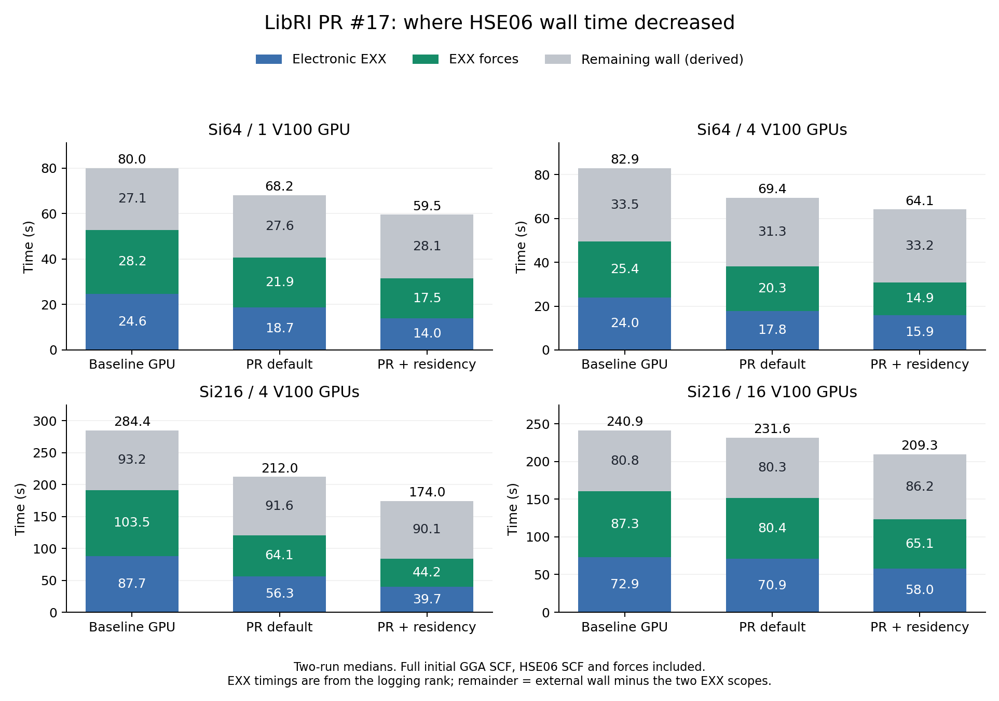

# Where the end-to-end time was reduced

The final ABACUS timing tables locate the main savings in electronic exact exchange and exact-exchange forces. The call counts are unchanged: 8 electronic EXX calls for ideal Si64, 7 for ideal Si216, 12 for displaced Si64, and one EXX-force call in every run. The change is time per call, with the same convergence work.

**PR comparison, Si216 / 4 V100 GPUs.** All entries below are medians of the same two runs per configuration, in seconds. The two EXX rows and the derived remainder add up to the external wall time. The later diagnostic timers overlap the remainder or each other and must not be added to those rows.

| Timer / phase | Baseline GPU | PR default | PR + residency | Baseline -> resident seconds saved |
| --- | --- | --- | --- | --- |
| External wall | 284.45 | 211.96 | 174.00 | 110.45 |
| Electronic EXX: cal_exx_elec | 87.74 | 56.27 | 39.66 | 48.08 |
| EXX forces: cal_exx_force | 103.55 | 64.12 | 44.23 | 59.32 |
| Remaining wall, subtracting the two EXX phases | 93.16 | 91.58 | 90.11 | 3.05 |
| EXX geometry preparation: cal_exx_ions | 31.43 | 30.54 | 30.18 | 1.26 |
| ELPA diagonalization: elpa_solve | 16.32 | 15.73 | 14.32 | 2.00 |
| Effective potential: Potential.cal_veff | 19.68 | 19.61 | 19.58 | 0.10 |
| LibXC potential: v_xc_libxc | 7.18 | 7.16 | 7.09 | 0.09 |
| Local-potential grid integration: Gint.cal_gint_vl | not fully printed | 3.08 | 3.85 | not fully printed |

The electronic EXX timer saves 48.08 s and the EXX-force timer saves 59.32 s, together about 97.2% of the 110.45 s reduction in external wall time. EXX geometry preparation stays near 30–31 s and effective-potential work near 19.6 s. ELPA decreases by about 2 s; its baseline samples span 14.58–18.05 s and the resident samples 14.29–14.34 s. Those small sample counts and the shared node do not establish an ELPA optimization.

**Baseline GPU -> PR + residency, all formal cases.** Positive values denote time saved; a negative remainder means the time outside the two EXX phases increased. The remainder includes other computation, communication/waiting and process launch/exit; it is calculated by subtraction, not measured by a separate timer.

| Case | Wall saved / s | Electronic EXX saved / s | EXX forces saved / s | Remainder saved / s |
| --- | --- | --- | --- | --- |
| si64-g1 | 20.44 | 10.69 | 10.75 | -1.00 |
| si64-g4 | 18.81 | 8.11 | 10.48 | 0.22 |
| si216-g4 | 110.45 | 48.08 | 59.32 | 3.05 |
| si216-g16 | 31.60 | 14.91 | 22.16 | -5.47 |

For Si216/16 GPUs, electronic EXX drops from 72.90 to 57.99 s and EXX forces from 87.29 to 65.13 s, saving 37.07 s inside those scopes. The external wall time saves 31.60 s because the derived remainder rises by 5.47 s. One visible increase is `Gint.cal_gint_vl`: 2.49 [2.48, 2.50] -> 2.82 [2.77, 2.86] -> 6.13 [6.10, 6.15] s for baseline/default/resident. This is local-potential grid integration, distinct from evaluating the LibXC functional. `HamiltLCAO.updateHk` and `HSolverLCAO.solve` contain this work, so their increases must not be counted again. ELPA remains essentially unchanged at 23.92 -> 23.97 s. A smaller grid-integration increase also appears in Si64 (single GPU: 2.32 -> 3.41 s; four GPUs: 1.43 -> 3.02 s). The existing timers do not establish why these increases occur.

**Parent scopes.** Electronic EXX is included in the SCF loop, and EXX forces are included in the complete force calculation. These parent scopes show where the user-visible savings occur, but summing them with their children would double count.

| Case | SCF loop: baseline -> resident / s | Complete forces: baseline -> resident / s |
| --- | --- | --- |
| si64-g1 | 41.94 -> 32.20 | 29.73 -> 18.92 |
| si64-g4 | 39.66 -> 32.75 | 26.04 -> 15.55 |
| si216-g4 | 136.12 -> 86.90 | 106.31 -> 46.96 |
| si216-g16 | 109.03 -> 97.83 | 88.20 -> 66.09 |

**LibRI CPU -> GPU backend switch at the baseline commit.** Displaced Si64, four GPUs, one run per configuration; the LibXC backend is held fixed within each comparison.

| Fixed LibXC | Phase | LibRI CPU / s | LibRI GPU / s | Saved / s |
| --- | --- | --- | --- | --- |
| cpu | External wall | 135.69 | 88.20 | 47.49 |
| cpu | Electronic EXX | 59.53 | 29.04 | 30.49 |
| cpu | EXX forces | 39.18 | 20.75 | 18.43 |
| cpu | Remaining wall (derived) | 36.98 | 38.41 | -1.43 |
| gpu | External wall | 129.87 | 82.90 | 46.97 |
| gpu | Electronic EXX | 58.44 | 28.74 | 29.70 |
| gpu | EXX forces | 39.00 | 21.33 | 17.67 |
| gpu | Remaining wall (derived) | 32.43 | 32.83 | -0.40 |

With LibXC fixed to CPU, electronic EXX drops from 59.53 to 29.04 s and EXX forces from 39.18 to 20.75 s. Together they save 48.92 s, while total wall time saves 47.49 s. ELPA stays at 5.86 -> 5.96 s and LibXC at 5.67 -> 5.57 s. The same localization is seen with LibXC fixed to GPU. Switching LibXC itself is a separate effect: its potential timer drops from 5.67 to 2.68 s with LibRI fixed to CPU, and from 5.57 to 2.62 s with LibRI fixed to GPU.

**Interpretation and limits.** These are elapsed times from the final running log, recorded with MPI_Wtime in the MPI build on the logging rank. They include work and waits inside each function; they are not CUDA kernel timings or a sum across ranks. The default output suppresses timers below 1% of program time, so missing entries are kept as missing rather than zero. Per-run values are rounded by ABACUS to 0.01 s before aggregation. The plotted remainder combines these internal timers with the external MPI-launch wall clock and is an approximate diagnostic decomposition. With only two formal samples, minor changes and shared-node variation do not establish causation.

The observed reduction is consistent with the PR optimizing packing, batch-plan reuse and data residency within LibRI. The application timing table does not separate host packing, host-to-device transfer, GPU GEMM, allocation or synchronization. Assigning an exact fraction to any of those operations would require additional profiling.

The source scopes were checked in pinned ABACUS `4e9f1636b7ca`: `source/source_base/timer.cpp` (`MPI_Wtime` and the 1% display threshold), `source/source_base/global_file.cpp` (running log), `source/source_lcao/module_ri/exx_lri.hpp` (`cal_exx_elec` / `cal_exx_force`), `source/source_esolver/esolver_ks.cpp` and `esolver_ks_lcao.cpp` (parent scopes).

Recompute the tables with `python3 scripts/analyze-timers.py`; add `--plot` to regenerate the PNG/SVG chart using matplotlib. The full printed timing table is exported to `results/timer-rows.csv`, all per-configuration medians/ranges to `results/timer-summary.csv`, and the differences to `results/timer-attribution.csv`.
